# Example flow: the factory loop

Source: `example_flow.jpg`, a photo of a presentation slide. The footer reads "Engineering the future of AI". The far right edge of the slide is cut off in the photo.

## What the slide shows

A flowchart of one item's path through an AI software factory, from a new task or issue to production and back. White boxes are steps, done either by an agent ("… agent runs") or by a human. Diamonds are decisions. Blue labels are the outcome taken at a decision or review.

## Transcription

```mermaid
flowchart LR
    new["New task or issue"] --> triage["Triage agent runs"] --> outcome{"Triage outcome"}

    outcome -- "Automat-able" --> impl["Implementation agent runs"]
    outcome -- "Needs specs due to scope or ambiguity" --> spec["Spec agent runs"]
    outcome -- "Needs human clarification" --> input["Human provides input"]
    outcome -- "Park for now" --> park["Park issue for now"]

    input --> triage

    spec --> specreview["Human review specs"]
    specreview -- "Needs revision" --> spec
    specreview -- "Approved" --> impl

    impl --> codereview["Code review agent runs"]
    codereview --> verify["Verification agent runs"]
    verify --> humanreview["Human reviews code and verification output"]
    humanreview --> ready{"Ready to ship?"}
    ready -- "Not ready" --> impl
    ready -- "Approved" --> cicd["CI/CD"]

    cicd --> ship["Ship it"] --> monitor["Monitoring agent runs"] --> issue{"Issue detected"}
    issue -- "No" --> cont["Continue monitoring"]
    issue -- "Yes - create issue" --> create["Create issue"] --> loop["Factory loop continues"] --> new
```

The "Not ready" path runs off the right edge of the photo and comes back in at the top, near the implementation and code-review agents. Sending it back to implementation is the most likely reading, but the exact target isn't visible.

## Step by step

1. **Intake.** A new task or issue arrives and a **triage agent** classifies it. The triage has four outcomes:
   - **Automat-able:** goes straight to the implementation agent, with no spec.
   - **Needs specs due to scope or ambiguity:** a **spec agent** writes a spec, and a **human reviews the spec**. "Needs revision" sends it back to the spec agent. "Approved" sends it on to implementation.
   - **Needs human clarification:** a **human provides input**, and the item goes back to triage with that input.
   - **Park for now:** the issue is parked and leaves the active flow.
2. **Build.** The **implementation agent** runs, then a **code review agent**, then a **verification agent**.
3. **Human gate.** A **human reviews the code and the verification output** and decides whether it's **ready to ship**. "Not ready" loops back for more work. "Approved" continues.
4. **Delivery.** **CI/CD** runs, then **Ship it**.
5. **Operate.** A **monitoring agent** watches production. If it finds no issue, monitoring continues. If it finds one, it **creates an issue**, and **the factory loop continues**: the new issue re-enters at step 1.

## What it means

- **It's a closed loop, not a pipeline.** Production monitoring feeds new issues back into intake, so the factory maintains software after it ships.
- **Agents do the work, humans hold the gates.** Every working step is an agent run. Humans appear in exactly three places: clarifying an unclear request, approving specs, and approving the ship decision. Human approval is the hard gate before spec→implementation and before shipping.
- **Triage sets how much process an item gets.** Clear, small work skips the spec stage. Large or ambiguous work gets a reviewed spec first. Unclear work is sent back to a human, and the triage agent does not guess. Work can also be parked deliberately.
- **Review comes in layers.** An AI code review and an AI verification run before the human review. The human judges the code *together with* the verification evidence, not the raw diff alone.
- **Rework is built in.** Two loops send work back: spec revision, and "not ready" back to implementation.

## How this maps to the taktloop proposal

This mapping is an interpretation; the slide doesn't contain it.

| Slide element | Proposal concept |
| --- | --- |
| Triage agent and its four outcomes | `triage` capability; an AI `choose:` among allowed transitions (`decide_next`) |
| "Needs human clarification" → back to triage | a human-bound step with a back-edge; `ai-task` returning `needs_human` |
| Spec agent → human review specs, "Needs revision" loop | `specifying` → `spec_review` in `feature.chart.yaml` |
| Implementation, code review and verification agents | executor plugins bound to `implement`, a review capability, and `run_ci`/verification |
| Human reviews code + verification, "Ready to ship?" | a hard gate (`hard: true`) over recorded outcomes |
| "Not ready" loop | a bounded back-edge (`attempts_below`) |
| Park for now | a parked/waiting state; the proposal doesn't model one yet |
| CI/CD → Ship it | `run_ci` / `deploy` capabilities; the release process |
| Monitoring agent → create issue → loop continues | not in the proposal; would be a shared or scheduled process that creates new items |
